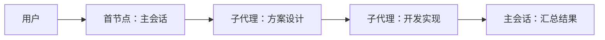
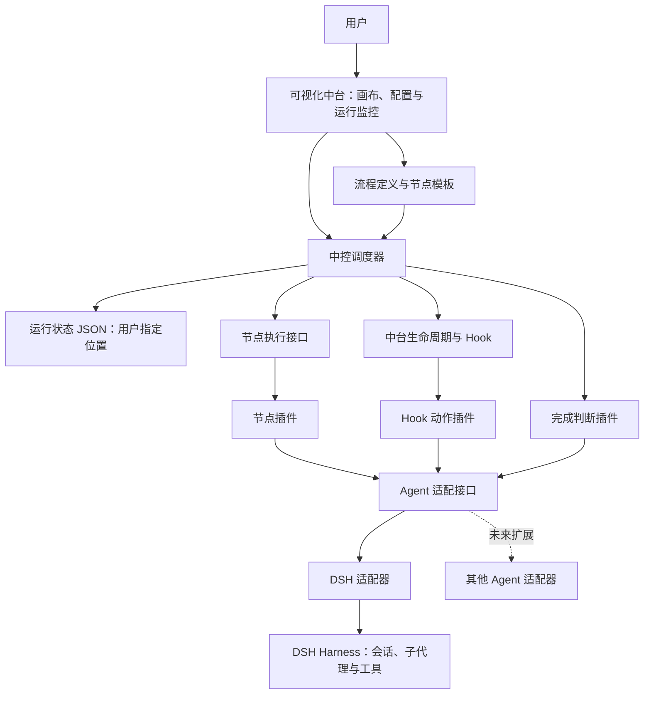

# DSH 拓扑编排需求与实现方案

> 状态：需求及初步实现方案。本文区分已确定的需求、建议方案和需要验证的 DSH 能力；现有 HTML 只是交互演示。

## 1. 需求

### 1.1 目标与范围

基于 DeepSeek Harness（DSH）构建任务编排中台。用户创建和配置主 Agent，通过主会话提出任务；用户使用类似发布流水线的拓扑画布定义任务步骤及其连接，查看节点执行状态和结果。

- 当前运行底座使用 DSH Harness；预留其他 Agent 的适配边界，当前不实现 Codex 兼容，也不接入模型网关。
- 支持创建多个主 Agent；一次流程运行以对应主会话为用户交互入口。首节点固定为主会话，不能更换节点类型。
- 后续步骤可以由主会话处理，也可以启动 DSH 子代理或执行自定义节点。拓扑由用户创建和控制，中台按照配置推进。
- 节点可配置执行会话，默认使用父节点关联的会话，也可选择根主会话或其他可用会话；选择会话的能力与节点类型分开配置。
- 画布用实线箭头展示前置执行依赖，节点卡片标注执行会话；无相互依赖的节点可并行调度。连线颜色区分未满足、已满足和阻塞。
- 支持快速创建步骤、复用步骤模板，并通过插件扩展节点类型、执行逻辑和配置。
- 每个节点可配置自己的 Hook：选择触发时机、填写动作描述，并可选配置输出文件的路径、格式和内容。
- 流程运行状态保存到用户指定位置的 JSON；节点或 Hook 的结果文件是否输出、输出位置和格式可单独配置。

### 1.2 主要概念

| 概念 | 含义 |
| --- | --- |
| 流程 | 用户搭建的一组节点、会话归属和执行依赖，描述任务步骤之间的关系。 |
| 流程运行 | 一次按流程定义执行任务的实例，有自己的状态和结果。 |
| 节点 | 流程中的一个步骤，例如主会话确认需求、子代理编写代码或人工确认。 |
| 节点说明 | 当前节点要达成的最终目标及预期结果，不等同于整条流程的最终目标。 |
| 完成条件 | 判断当前节点是否达到目标、能否继续的依据。 |
| 执行会话 | 节点执行时关联的 Agent 会话；子代理会话是可选上下文，不因此变成根主会话。 |
| Hook | 绑定在节点上的触发时机与处理动作，可选择中台节点生命周期或 DSH 事件。 |

## 2. 流程与逻辑

### 2.1 创建和运行流程

1. 用户选择主 Agent，在画布中配置首节点目标，并添加后续节点和连接。
2. 用户按需为节点选择模板、执行会话、完成条件和 Hook；设置运行状态 JSON 的位置。
3. 用户在主会话中提出任务，中台创建一次流程运行，并关联主会话。
4. 调度器按拓扑启动节点，记录状态；节点由主会话、子代理或节点插件执行。
5. 节点完成并通过必要的检查和后置 Hook 后，调度器启动满足条件的后续节点。
6. 后续节点按配置使用选定会话；中台将上游结果显式提供给需要它们的节点。默认父节点会话不可用时，不自动切换到根主会话。



上图仅示意步骤；实际画布中实线箭头表示前置依赖，节点卡片展示执行会话。“汇总结果”如需使用根主会话，须显式选择该会话；节点类型不自动决定上下文归属。

### 2.2 节点推进规则

```text
节点开始前 Hook → 执行节点 → 获取本次执行结果
→ 判断完成条件 → 成功前 Hook → 记录成功 → 成功通知 → 调度后续节点
```

- 主会话的一次回复可能是追问；需要继续对话或等待用户确认时，节点保持等待，不自动推进。
- 子代理结束表示一次运行已收尾；中台还要检查其结束原因和节点要求，不能仅凭结束通知认定任务成功。
- 用户确认、模型判断和插件检查可作为完成条件的候选方式。自然语言目标或模型自报完成不构成程序级验收保证；具体判断方式待设计。
- 节点失败、取消、阻塞或需要确认时不按成功推进。重试、失败分支、分支汇合及并行规则需要在流程配置和调度器设计中进一步确定。
- 一个拓扑节点可以包含多个 DSH Step 或对话轮次；单次 `step/end` 或一次主 Agent 回复不等于节点完成。
- 前置依赖默认要求全部前置节点成功后触发；无相互依赖的节点可以并行调度。同一会话是否能同时执行多个节点需要根据 DSH 能力协调，不能假设一定并行。任一成功、失败继续等汇合策略待设计。
- 前置依赖候选项排除自身、循环依赖和已通过已选前置节点间接依赖的节点。既有重复依赖保留并提示；上游关系变更时不自动增删依赖。此去重规则适用于“全部成功”，其他汇合条件需重新评估。
- 首节点不设置前置依赖；从某个节点新增子节点时，默认以该节点为前置依赖，用户可以取消或调整。候选项随选择实时更新，保存时校验循环依赖。
- 画布按依赖层级自动排布；相邻层使用曲线，跨层连线在节点范围附近择上方或下方绕行，减少遮挡。多条连线交叉仍需进一步优化。

调度器维护每次运行的节点状态，将 DSH、用户或插件提供的结束信号与流程运行 ID、节点 ID、执行次数及执行标识关联。节点通过完成条件和必需结束 Hook 后才标记成功；每次状态变化时检查受影响后续节点的所有前置状态。多项依赖默认全部成功才启动，并须通过串行处理或原子状态转换防止并发通知重复启动。重启恢复和副作用去重仍需实现验证，详细过程见[节点调度设计记录](./节点调度设计记录.md)。

### 2.3 Hook 执行逻辑

| 触发来源 | 示例 | 职责 |
| --- | --- | --- |
| 中台节点生命周期 | 节点开始前、成功前、成功通知 | 由调度器定义触发时机和等待规则；成功前检查可配置推进条件。 |
| DSH 运行时事件 | `agent/pre-step`、`tools/pre-execute`、`tools/post-execute`、`fs/edit-intent` | 节点执行期间按事件契约处理，必要时按 Agent、工具和文件等条件过滤。 |

一次 Hook 配置包括触发事件、动作描述及可选输出；工具或文件事件还可配置过滤条件。动作可考虑投递给当前子代理继续处理，或启动独立子代理；等待、决策及失败行为必须由相应执行器和事件契约确定。

节点开始前和成功前检查由中台调度器触发，并等待必需 Hook；成功状态记录后再发出成功通知。DSH 事件由 DSH 在对应运行时行为发生时触发。中台监听并匹配执行实例后再判断节点状态，不能将普通通知直接当成中台可等待的生命周期门禁。失败、取消及通知失败的处理策略待实现设计。

DSH 事件有通知、串行监听和 waterfall 等不同形式，不能都当作可阻断的前后置流程。工具执行前模型已选择工具；工具执行后不等于整个代码任务完成。文件意图事件只覆盖相应文件工具的执行路径，终端等其他写文件方式未必经过这些事件。[DSH 工具文档](https://github.com/deepseek-ai/deepseek-harness/blob/dsh-v0.2.2-rc.3/docs/subsystems/tools.md)、[文件系统文档](https://github.com/deepseek-ai/deepseek-harness/blob/dsh-v0.2.2-rc.3/docs/subsystems/filesystem.md)

## 3. 功能模块

| 模块 | 功能 |
| --- | --- |
| 主 Agent 与会话 | 创建和配置多个主 Agent；对话、显示结果，并关联流程运行。 |
| 流程画布 | 展示拓扑和运行状态；右键节点提供编辑和新增子节点；顶部显示运行状态与状态文件地址。 |
| 节点与模板 | 配置节点目标、类型、执行会话、完成条件及模板；首节点固定主会话。 |
| 节点插件 | 提供节点配置和执行能力，统一向中台报告状态、结果和失败原因。 |
| Hook | 为节点配置生命周期或 DSH 事件、动作描述及可选输出。 |
| 调度与状态 | 按拓扑启动节点、判断完成条件、记录运行状态，协调主会话和子代理。 |
| 运行与结果 | 显示节点状态及结果；维护运行状态 JSON 和按需生成的结果文件。 |
| Agent 适配器 | 将中台能力映射到 DSH，声明实际支持的操作和事件；为未来其他 Agent 预留接口。 |
| 扩展插件 | 注册节点类型、Hook 动作、完成判断、输入输出和模板。 |

首节点为固定的根主会话入口；后续节点类型的初步范围包括会话步骤、子代理、人工确认和自定义节点。后续会话步骤复用所选会话，不创建新的根主会话；当前 HTML 的类型列表尚未提供该入口。原型曾提供结果输出节点；用户已要求移除节点配置中独立的结果输出模块，当前在每个 Hook 下配置可选输出。是否保留独立“结果输出”节点类型，尚未单独确定。

## 4. 实现方案

### 4.1 职责划分

建议采用“**可视化中台 + 中控调度器 + 插件扩展 + Agent 适配器**”的架构，作为 DSH 插件及其界面实现。首版使用 DSH Harness；其他 Agent 的适配仅预留边界，不表示已兼容。



图中适配器连线表示需要 Agent 能力时的调用方向；人工确认、文件处理等插件也可由中台自身执行，不必经过 Agent。各层职责如下：

| 层次 | 职责 |
| --- | --- |
| 可视化中台 | 配置流程、节点、执行会话、依赖和 Hook；查看节点状态、错误及结果地址。 |
| 中控调度器 | 创建流程运行、判断依赖、触发生命周期、派发节点、检查完成条件并维护运行状态。 |
| 插件扩展 | 提供节点类型、Hook 动作、完成判断、输入输出和模板；不接管全局调度。 |
| Agent 适配器 | 将统一能力映射到 DSH 的会话、子代理、工具与事件，并声明实际支持范围。 |
| 状态与结果存储 | 中控将同一次运行的状态和可选结果地址写入用户指定的 JSON；节点或 Hook 结果文件按配置单独输出。 |

DSH 提供 Agent、Session、工具及事件能力；中台维护拓扑节点、条件、任务结果和调度。中台节点生命周期是自定义扩展点，不能把 DSH `workflow/phase` 或 `subagent/end` 直接当作通用节点门禁。

中台的调度器作为统一中控：接收节点结果、维护状态、判断依赖并启动后续节点；节点之间不直接负责通知或调度，主会话也不需要作为完成事件转发器。用户指定的运行状态 JSON 记录同一次流程运行的节点状态及可选结果地址，由中控统一维护并用于展示和恢复；文件是状态存储，运行时判断由调度器完成。中控不要求是一个独立 Agent。

多主 Agent 是配置层能力。每次流程运行关联一个主会话；DSH 子代理可拥有独立 Session。建议记录流程运行 ID、节点 ID、执行次数与实际 Session ID，并显式传递上游结果，不假设子代理自动共享全部对话上下文。

**执行会话选择**：节点编辑时可选父节点会话（默认）、根主会话或其他运行中可用的会话。流程定义保存可解析的选择规则或节点引用；每次运行再解析实际 Session ID，并记录到运行状态中，避免将某次运行的临时 ID 固定到模板。多个父节点时，默认会话的确定规则及可选会话范围待设计，不应任意猜测。

子代理节点通过所选会话创建子代理；自定义节点是否使用会话上下文及如何执行，由节点插件契约定义。调度前需检查目标会话是否存在、允许继续且具备相应能力；不可用时等待或失败并提示，不静默切换会话。对同一会话的并发节点，需要协调输入、结果归属及 Goal 冲突；具体排队和取消策略待验证。子代理会话在结束后能否继续或恢复依赖实际 DSH 后端，不能假设一定可用。

适配器应声明继续会话、恢复和创建子代理等能力；保存流程时检查已知限制，启动时核对实际会话。未知能力不能视为支持。节点执行器的启动、执行标识、状态、结果、取消和恢复契约，以及会话步骤的结果关联协议，详见[节点调度设计记录](./节点调度设计记录.md)。

**完整运行示例**：用户在主会话提出任务后，中控创建运行记录；依次调度需求分析子代理、方案设计会话步骤、人工确认和开发子代理。每个节点先检查前置依赖并执行必需的开始前 Hook，再由对应节点插件通过 DSH 适配器或中台执行器启动；中控收到结果后检查完成条件、等待必需的成功前 Hook、记录成功并判断后续节点。用户确认、上游结果和可选文件输出均按节点配置处理。子代理结果如何交给主会话、多个前置节点如何汇合，详见[节点调度设计记录](./节点调度设计记录.md)。

### 4.2 数据与存储

已确定运行状态写入用户指定的 JSON 文件。建议每次运行独立标识，并记录流程版本或快照、节点状态、执行次数、关联会话、Hook 状态和结果位置。以下仅为字段方向，尚非最终格式：

```json
{
  "runId": "run-example",
  "flowId": "page-development",
  "status": "running",
  "mainSessionId": "session-example",
  "nodes": {
    "design": {
      "status": "running",
      "attempt": 1,
      "agentSessionId": "child-session-example",
      "resultPath": null
    }
  }
}
```

该 JSON 是中台运行状态；DSH Session 自己维护会话事件，两者通过标识关联。节点或 Hook 的业务结果可不输出文件，也可按配置输出 JSON、Markdown 或其他格式；其 JSON 字段和路径由模板或插件定义。流程定义和步骤模板的文件格式尚未最终确定，YAML 或 JSON 均可作为后续候选。

建议结果通过带类型的引用关联：可以是运行状态 JSON 中的内联结果、用户配置的结果文件或经验证可恢复的 Session 结果；仅存在内存的结果不保证重启可用。下游启动前解析所需结果，缺失时等待或阻塞并提示。要求持久化的结果和必需输出确认可读后再提交成功；跨文件部分失败的恢复 / 补偿仍待设计。

建议单个运行由一个写入者串行更新状态，并验证 Windows 下的安全替换行为；状态 JSON 与结果文件不是天然的同一事务，重启时需要核对实际状态，不应盲目重放已执行的副作用。运行时是否持久保存完整对话由 DSH 的 Session 后端决定，不由中台状态 JSON 自动保证。

### 4.3 Goal 与节点完成

Goal 可作为可选完成条件：中台关联目标与节点，在收到 `goal/changed` 后检查正确 Goal 的状态是否为 `complete`，再等待相关执行与必要 Hook 收尾。`goal/change` 是 Session 中的状态变更记录。Goal 的创建、暂停和完成受 DSH 服务及工具权限约束，Goal 的完成也可能依赖模型判断。[DSH Goal 文档](https://github.com/deepseek-ai/deepseek-harness/blob/dsh-v0.2.2-rc.3/docs/subsystems/goal.md)

待验证事项：主会话如何将节点与 Goal 精确关联；中台能否为子代理创建并驱动 Goal；Goal 自动续跑及 Session 恢复；同一 Session 的 Goal 节点如何排队。DSH 自带模型工具不允许子代理自行创建 Goal，不能假设普通提示词就能完成上述接入。[DSH Goal 工具权限](https://github.com/deepseek-ai/deepseek-harness/blob/dsh-v0.2.2-rc.3/packages/goal/tool-goal/README.md)

建议第一阶段先验证主会话与子代理的结果回传、状态关联和节点推进，再验证 Goal；是否把 Goal 作为默认完成方式尚未确定。

### 4.4 插件扩展与 Agent 适配

本节为建议协议，事件名和工具名均为中台拟定义的示例，不是已存在的 DSH API。第一版只接入 DSH；其他 Agent 能否支持相同语义，应在实际接入时逐项核对。

```text
流程画布 → 中控（状态、依赖与调度） → 中台插件接口
                                    ├─ 节点 / Hook / 判断 / 数据插件
                                    └─ Agent 适配器 → DSH；未来可增加其他适配器
```

#### 中台自定义事件

事件是扩展点，Hook 动作是插件注册在扩展点上的处理。以下事件由中台根据自己的状态转换触发，不依赖 Agent 存在同名事件：

| 类别 | 建议事件 | 用途 |
| --- | --- | --- |
| 流程 | `flow/before-start`、`flow/started`、`flow/paused`、`flow/resumed`、`flow/completed`、`flow/failed`、`flow/cancelled` | 运行前初始化、展示状态、记录结果。 |
| 节点 | `node/before-start`、`node/started`、`node/waiting`、`node/before-complete`、`node/completed`、`node/failed`、`node/cancelled`、`node/retrying` | 节点前置处理、结果检查、成功或失败通知。 |
| 依赖与调度 | `dependency/changed`、`dependency/satisfied`、`dependency/blocked`、`schedule/before-dispatch`、`schedule/dispatched` | 展示依赖变化、派发前检查和关联执行标识。 |

`node/before-complete` 用于成功前检查，`node/completed` 表示中控已经认定节点成功；两者不能混为一谈。是否等待、处理顺序、失败和取消行为需要定义在中台事件与 Hook 契约中。最终事件集合和命名待实现时确定。

#### 统一 Agent 事件与能力声明

Agent 适配器接收原生事件，并在语义匹配时转换为中台事件；保留来源和必要的原始数据。以下映射以 DSH v0.2.2-rc.3 为例，具体支持和语义需以实际版本核验：

| 中台事件示例 | DSH 原生事件 | 说明 |
| --- | --- | --- |
| `agent/status-changed` | `agent/status` | Agent 状态变化。 |
| `agent/step-before` | `agent/pre-step` | 模型步骤输入处理。 |
| `subagent/started` / `subagent/ended` | `subagent/start` / `subagent/end` | 子代理生命周期通知；结束不等于节点成功。 |
| `tool/before-execute` / `tool/after-execute` | `tools/pre-execute` / `tools/post-execute` | 工具执行前后，遵循原事件契约。 |
| `file/write-intent` / `file/edit-intent` | `fs/write-intent` / `fs/edit-intent` | 仅覆盖相应文件工具路径。 |

适配器应声明事件是否支持、能否等待、阻止或修改，以及配置的生效时机；中台据此限制画布中的可选动作。普通 `emit` 通知不能包装成可阻止的同步门禁。不存在或语义不匹配的能力明确显示不支持，不能仅依靠统一命名保证兼容。[DSH 子代理事件](https://github.com/deepseek-ai/deepseek-harness/blob/dsh-v0.2.2-rc.3/docs/subsystems/subagent.md)、[DSH 工具事件](https://github.com/deepseek-ai/deepseek-harness/blob/dsh-v0.2.2-rc.3/docs/subsystems/tools.md)

统一事件上下文建议包含流程运行 ID、节点 ID、执行次数、会话 ID、来源和原始事件引用；适配器无法获取的字段必须标明缺失，不能猜测关联。

#### 节点、判断和 Hook 动作插件

**节点插件提供节点能力，中控控制流程。** 画布上的节点主要是配置；调度器判断依赖满足后，根据节点类型找到对应执行能力。节点插件负责定义需要的配置、启动工作和返回结果；中控负责判断何时启动、检查完成条件、记录状态和决定是否推进下游。节点插件无需知道下一节点是谁，也不直接决定整条流程的走向。

例如：

```text
中控：需求分析节点的前置依赖满足
  → 子代理节点插件：通过 DSH 适配器启动子代理并获取结果
  → 中控：检查结果和完成条件、记录状态、判断后续节点
```

人工确认节点插件则提供另一种执行能力：展示确认并等待用户决定，再把结果交给中控。节点插件是本编排中台拟设计的扩展概念，DSH 不会自动提供拓扑节点注册表；注册接口及其生命周期需要实现。

**节点模板保存配置，不实现执行能力。** 例如“需求分析”和“代码审查”可以是两个模板，分别预填节点说明、执行角色、Hook 和完成条件，但共同使用“子代理”节点插件。用户选择模板后仍可调整配置。

首版可先将基础节点执行能力内置在中台中，再按需求开放独立插件注册；是否支持独立安装、卸载及运行中卸载的处理仍待设计。

| 插件类别 | 建议能力 | 约束 |
| --- | --- | --- |
| 节点类型 | 会话步骤、子代理、人工确认、自定义节点；以后可增加脚本、条件、结果整理等节点。 | 定义配置、校验、启动、结果及适用的取消与清理契约；Agent 能力不足时不可运行。 |
| 完成判断 | 执行结果、Goal、文件检查、模型判断、人工确认及组合判断。 | 插件给出判断依据，中控负责最终状态与推进；模型声明并非独立验收。 |
| Hook 动作 | 规则、技能、MCP、工具配置，结果转换、文件输出和人工确认。 | 注入能力、作用范围和生效时机由适配器声明；不能假设运行中动态生效。 |
| 数据与模板 | 输入组装、输出解析、结果存储、状态存储、结果展示和节点模板。 | 首版状态存储采用用户自定义路径的 JSON；输出文件可选。 |

中控统一负责依赖汇合、节点状态、执行标识、重复启动防护及状态写入；插件不直接接管全局调度或并发写共享状态文件。

#### 中台接口与模型工具

区分两类能力：

1. **中台调用 Agent 的适配接口**：创建或获取会话、发送任务、启动子代理、获取结果、取消执行、查询状态、订阅事件和查询配置能力；每项允许明确返回不支持。
2. **可选的模型工具**：例如 `orchestrator_get_node`、`orchestrator_report_progress`、`orchestrator_submit_result`、`orchestrator_request_input` 和 `orchestrator_get_upstream_results`，分别用于读取当前节点、报告进度、提交结果、请求输入及获取上游结果。工具名为设计示例；由中控验证和接收报告，不能让工具调用直接决定节点成功或启动下游。

DSH 能直接返回的子代理结果可由适配器收集，不必强制模型调用报告工具。各种 Agent 的工具暴露、会话继续、子代理创建和配置注入能力均需逐项验证。

### 4.5 实施与验证顺序

1. **界面原型**：确认画布、首节点、节点配置和 Hook 交互；当前已有独立 HTML 演示。
2. **DSH 接入验证**：验证主会话输入与结果关联、子代理启动和结果返回、事件作用域与插件生命周期。
3. **调度与持久化**：实现流程定义、节点状态、完成条件、状态 JSON 写入及失败处理。
4. **Hook 与扩展**：接入节点生命周期和选定 DSH 事件，实现动作执行与可选输出。
5. **Goal 验证与完善**：验证主会话及子代理场景，再决定 Goal 的配置与推进方式。

首版先覆盖中控与 JSON 状态、流程和节点基础生命周期、DSH 会话和子代理适配、基础节点及规则 / 结果 / 文件动作、执行结果与人工确认等判断，并逐项声明已验证能力；Goal 判断和其他 Agent 适配按验证结果再推进。

每阶段应核对相应的用户操作和失败场景。当前已有一个 React / DSH 接入纵向切片：面板提交活动主会话 ID、子代理目标和用户指定状态 JSON 地址，中控启动 `spawn` 子代理并等待该次执行结果，再进入人工确认。该切片与 `index.html` 画布仍相互独立；尚未从画布配置运行完整 DAG、自动监听主会话 Goal、支持 Hook、并行调度或重启恢复。详见同目录 `README.md` 和《节点调度设计记录》。
